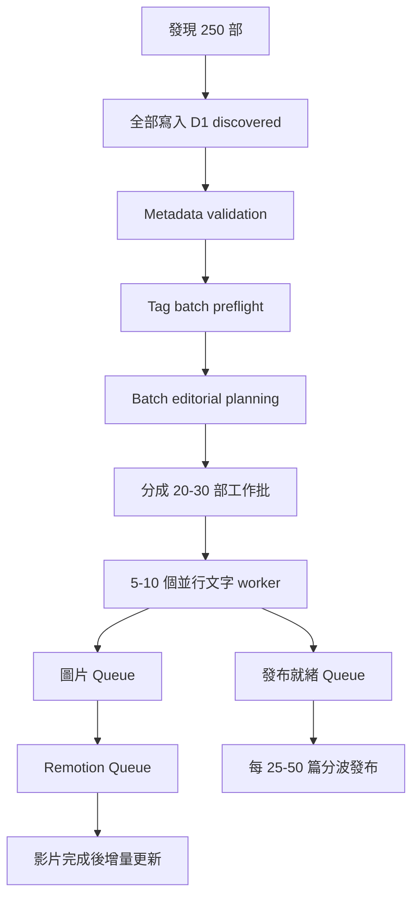

# 擷取與突發批次

## 1. Scout 排程

- 正式期建議每 6 小時檢查最新列表；若來源負載或規則不允許，可降為每日。
- 每次先讀列表，再逐部開啟候選作品頁取得實際日期與完整欄位。
- 掃描安全窗口建議 14 天；主要新片顯示窗口可維持 7 天。
- 使用節流、jitter、快取與合理 User-Agent；不得繞過登入、付費牆、CAPTCHA 或安全阻擋。
- 正式啟用前需確認 robots、服務條款與可接受頻率。

## 2. 初次 Watermark

初次啟動不能把歷史庫當成新片：

1. 盤點最新列表與日期分布。
2. 建立 `launch_watermark_at` 與來源 cursor。
3. 只選最近窗口內的一部作品做真實測試。
4. 上線後首次出現在 watermark 之後的項目全部登記。
5. watermark 前的作品標為 `prelaunch_history`，除非另行啟動受控回補。

## 3. 新片資格

同時保存：

- `release_date`：作品頁的實際日期。
- `first_seen_at`：本站第一次發現時間。
- `source_updated_at`：若來源可提供。

穩態營運時，Registry 未出現、且位於來源新進區的作品均先登記。實際日期決定網站排序；明顯多年舊片重上架標為 `late_arrival` 或 `source_reissue`，由自動政策決定是否收錄。

## 4. 異常保護

大量新增不是錯誤；250 部應視為正常可承受 burst。仍需偵測：

- 列表 selector 失效導致所有舊頁被判成新片。
- 番號解析突然大量為空。
- 日期格式失效。
- 同一來源 UUID 重複無限出現。
- 單批數量超過設定的合理上界且資料分布異常。

異常時不花費 AI／圖片成本；先保存診斷摘要並保留上一個有效 cursor。若無人介入，下一輪使用上一版 extractor 重試；持續失敗則保持來源暫停，但其他發布與影片 retry 繼續。

## 5. Burst 處理

## 6. 優先順序

1. Metadata 與去重：全批最快完成。
2. Tag／文章／Hero：優先達成可發布狀態。
3. 額外情境圖。
4. Remotion MP4。
5. 歷史性低優先重試。

Queue 依 `release_date`、`first_seen_at`、backlog age 與 retry 類型計算優先級，避免較舊工作永久飢餓。

## 7. 來源快照

保存正規化 JSON、來源 URL、擷取時間與內容 hash。原始 HTML 只在 extractor 測試所需時保存有限 fixture，不大量鏡像整站。來源簡介可供內部生成與稽核，但公開頁必須使用原創改寫。

