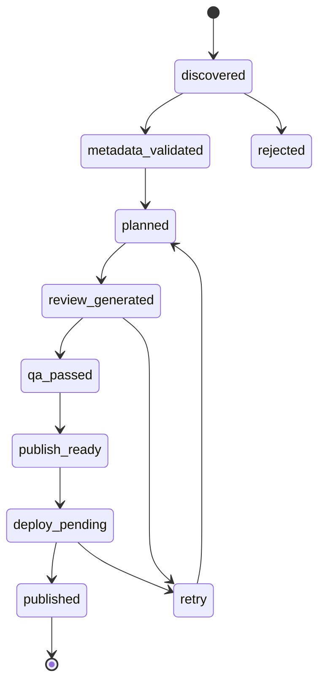

# 資料與狀態

## 1. 權威來源

| 資料 | 權威來源 | Git 中的形式 |
|---|---|---|
| 工作狀態、lease、retry | D1 | Registry export／run summary |
| 已發布文章 | Git Markdown | 原檔 |
| Taxonomy 規則 | Git | JSON/YAML |
| 來源事實快照 | Git | 正規化 JSON |
| 生成媒體 | R2 | media manifest 與 URL |
| 部署狀態 | D1＋GitHub deployment | run summary |

`data/movie-registry.json` 是由 D1 自動匯出的快照，不允許平行 worker 直接編輯。恢復時可以由最新快照與 Git 文章重新建立 D1。

## 2. 核心實體

- `Movie`：以正規化番號為優先唯一鍵。
- `SourceRecord`：來源 URL、UUID、擷取欄位、hash 與時間。
- `Performer`：演員實體及多語別名。
- `Studio`：片商／品牌，不當作 Tag。
- `Series`：系列實體，不當作 Tag。
- `Review`：文章版本、核心切角、結構化內容。
- `Tag`：Canonical 或 Editorial taxonomy 定義。
- `TagAssignment`：文章與 Tag 的關聯及證據。
- `MediaAsset`：R2 object、版本、hash、尺寸與狀態。
- `PipelineJob`：可領取、租約化、可重試工作。
- `PublicationBatch`：一批 Git commit／deploy 的交易紀錄。

## 3. Movie 狀態



文章、圖片與影片使用獨立狀態，不用單一總狀態掩蓋部分失敗：

```json
{
  "review_status": "published",
  "tag_status": "classified",
  "hero_status": "generated",
  "images_status": "partial",
  "video_status": "retry",
  "deployment_status": "success"
}
```

## 4. Pipeline job 與 lease

每個工作必須具備：

- `idempotency_key`
- `stage`
- `status`
- `attempt`
- `max_attempts`
- `claimed_by`
- `lease_expires_at`
- `next_retry_at`
- `last_error_code`

Worker 只能原子地領取未被租用或租約已過期的 job。執行時間超過 lease 時必須續租；程序中斷後，其他 worker 可在租約過期後接手。

## 5. 正規化與去重

番號正規化範例：

```text
royd341  -> ROYD-341
ROYD341  -> ROYD-341
royd-341 -> ROYD-341
```

去重優先序：

1. `normalized_movie_id`
2. 已知來源 ID 對照
3. `normalized_title + release_date + primary_performer`
4. 低信心衝突進入自動隔離，不合併資料

同一番號可能有多個來源 UUID，保存於 `source_variants`，不可因此產生兩篇文章。

## 6. 版本與血緣

每篇文章保存：

- `source_snapshot_hash`
- `taxonomy_version`
- `prompt_version`
- `model_id`
- `content_brief_version`
- `review_version`
- `media_version`
- `generated_at`

來源內容改變時，先比較 hash；只有關鍵事實變更才建立更新工作。純排版或推薦區變更不重寫影評。


