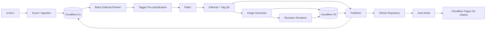

# 系統架構

## 1. 邏輯架構



## 2. 平台責任

| 平台 | 責任 | 不負責 |
|---|---|---|
| GitHub | 程式、Markdown、Taxonomy、Schema、來源快照、Registry export、CI/CD | 大型媒體與即時工作鎖 |
| GitHub Actions | 排程、Dispatcher、AI、Remotion、QA、commit | 長期資料庫與 Pages deploy |
| Cloudflare D1 | 營運 Registry、Queue、lease、retry、成本、批次、狀態 | 已發布文章本文 |
| Cloudflare R2 | 生成圖片、MP4、poster、media manifest | 程式碼與文章版本 |
| Cloudflare Pages | Git-based Astro build、preview、production deploy | 影片渲染與內容生產 |
| OpenAI API | 文字分析、影評、QA、非露骨圖片 | 決定性去重與資料庫狀態 |
| Remotion | 圖片／文字／動畫合成 MP4 | 生成來源影片內容 |

## 3. Repository 建議結構

```text
cc18/
├─ src/                          # Astro layouts/components/pages
├─ public/                       # 網站靜態資產
├─ video/                        # Remotion compositions
├─ content/reviews/
├─ data/
│  ├─ movie-registry.json        # D1 匯出快照
│  └─ taxonomy.json
├─ config/                       # pipeline policy
├─ cloudflare/                   # Cloudflare resource notes
├─ tests/                        # source parser fixtures
├─ docs/
├─ scripts/
└─ .github/workflows/
```

## 4. 環境

| 環境 | 用途 | 媒體 prefix | 部署 |
|---|---|---|---|
| local | 開發與 fixture | local temp | localhost |
| preview | PR 預覽 | `preview/{run-id}` | Preview URL |
| staging | 真實端到端驗證 | `staging/...` | Pages preview／staging project |
| production | 正式發布 | `production/...` | Pages production |

每個環境使用不同 GitHub Environment、Cloudflare token、D1 database 與 R2 prefix。正式 secret 不得提供給 pull request 的不可信程式碼。


